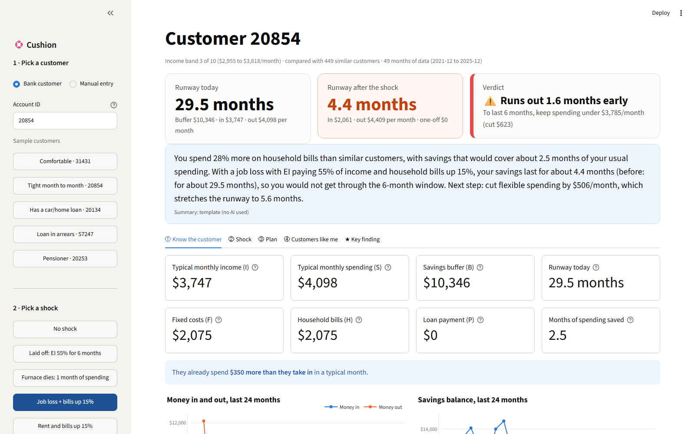

# 🛟 Cushion

**How long would your savings last if life hits?**
Cushion is a financial resilience engine for bank customers, built solo for the Tangerine track
"Resilience Rewired" at Sheridan Datathon 2026.

Pick any `account_id`, pick a shock (layoff on EI, higher rent or bills, a surprise repair, or a mix),
and in under a second Cushion shows:

1. **Know the customer:** typical income, spending, fixed costs, household bills, loan payment, savings buffer, and months of runway.
2. **Take a shock:** before/after runway, a month-by-month savings projection, and a clear verdict ("Makes it through the 6-month shock" or "Runs out 0.9 months early").
3. **Make a plan:** a goal plan (emergency fund) and a backup plan (ordered actions, each showing the runway it buys), built from that customer's own numbers.
4. **Customers like me:** how this customer compares with the ~450 customers in their income decile, and how the shock moves them among those peers.
5. **Key finding:** a checked pattern from all 4,500 accounts (below).

A plain-English summary sits at the top. It is written by Gemini when a key is available, and by a template otherwise.



## Key finding: higher earners are the most fragile

Apply the same layoff to everyone (EI at 55% of usual income for 6 months). In the **top income decile, 76% of
customers run out of savings before the 6 months end**, compared with about **5% in the bottom two deciles**.

Why: buffers grow with income (median $14,060 → $38,899 from the bottom decile to the top), but spending grows
far faster ($1,327 → $23,003). Savings therefore cover **1.6 months** of spending at the top versus **9.0** at the bottom.
With the real 2026 EI weekly maximum ($729/week), **94 to 100%** of the top three deciles run out.

How we checked it:
- Pensioners are excluded (740 accounts where pension is 5%+ of income), since a job loss would not stop a pension.
- The result holds for accounts with 24+ months of history (top decile 77%, bottom 6%), so new accounts with thin data are not driving it.
- The Spearman rank correlation between income and layoff runway is −0.68.
- Caveat: "spending" is all money out, including transfers. High earners may be moving money into savings this bank can't see.

## Run it

```bash
python -m venv .venv
# Windows: .venv\Scripts\activate     macOS/Linux: source .venv/bin/activate
pip install -r requirements.txt
streamlit run app.py
```

Optional AI summary: set `GEMINI_API_KEY` in your environment (or in `.streamlit/secrets.toml`, which is git-ignored).
Without a key, or with no internet or an API error, the app uses the template summary automatically.

Tests (102 total: runway and shock unit tests, plans, and a headless run of the whole app for 10 accounts × 6 presets):

```bash
pip install -r requirements-dev.txt
python -m pytest -q
```

Per-account stats are precomputed into `data/cache/stats.parquet` and `data/cache/monthly.parquet` (committed, about 4 MB).
To rebuild them from the CSVs, run `python -m cushion.data` (takes under a second). `transactions.csv` is not used.

### Deploy free on Streamlit Community Cloud

1. Go to https://share.streamlit.io and sign in with GitHub.
2. Click **Create app** → **Deploy a public app from GitHub**. Then set the repo to `Shayan-2/cushion`, the branch to `main`, and the main file to `app.py`.
3. Under **Advanced settings**, choose Python **3.12** and paste `GEMINI_API_KEY = "your-key"` into **Secrets**. The key is optional.
4. Click **Deploy**. The precomputed cache is in the repo, so the first load takes a few seconds.

## How every number is calculated

These match the judges' definitions in [TRACK_README.md](TRACK_README.md). They use `monthly_summary.csv` and `loans.csv`, and every amount is per month in CAD.

| Number | Definition |
|---|---|
| **I**, typical income | median of `money_in` |
| **S**, typical spending | median of `money_out` |
| **H**, household bills | median of `household_bills` |
| **F**, fixed costs | median of `household_bills + insurance + loan_payments` (shown, not used in runway) |
| **B**, buffer | mean of `avg_daily_balance` over the account's last 6 rows, sorted by month |
| **P**, loan payment | `monthly_payment` from `loans.csv` if the loan is running at end of 2025 (status C or D), else 0 |

**Runway**

```
buffer_left = B - one_off_costs
gap         = spending_after_shock - income_after_shock
if buffer_left <= 0:  runway = 0
elif gap <= 0:        runway = "no shortfall (120+)"
else:                 runway = min(buffer_left / gap, 120)      # rounded to 1 decimal
```

**Shocks** (all adjustable with sliders):
- Job loss with EI: income = EI rate × I (default 55%). An optional checkbox caps it at the 2026 EI maximum of $729/week ≈ $3,159/month. It is off by default to match the judges.
- Rent or household bills up x%: spending = S + x × H
- Surprise cost: one_off_costs = (months × S) + extra dollars. "A full month of typical spending" means one_off = S.
- Shock length (default 6 months) is the "do they make it?" horizon: they make it if runway ≥ length.

**Goal plan (emergency fund):** the target is 3 or 6 months of S. The monthly saving is half the usual surplus (I − S).
If there's no surplus, it comes from trimming 10% of flexible spending (S − F: cash, card and other transfers).
Time to goal = (target − B) ÷ monthly saving.

**Backup plan:** these are ordered actions, and each shows the runway after it and all the steps before it:
1. Spread a large surprise bill over 12 instalments.
2. Cut flexible spending (S − F) by 25%.
3. Pause the loan payment. Only the part of P that appears in spending counts; a loan in arrears may not be getting paid.
4. Win back half of a bill increase by negotiating or switching providers.
5. Apply for EI right away.

The **survival budget** is the most you can spend per month and still last the whole shock:
shocked income + (B − one_off) ÷ shock length.
For a customer with no buffer, the plan shows how each step shrinks the monthly shortfall instead.

**Peers ("Customers like me"):** customers are split into income deciles by I, about 450 accounts each. The comparisons are:
- the customer against the peer median for bills, spending and buffer
- their share of spending by category against the peer median share
- their runway rank among peers, before and after the same shock.

**AI summary:** Gemini (`gemini-3.8-flash`, Interactions API, low thinking) receives only about a dozen summary numbers:
income, spending, bills, buffer, peer differences, runway before and after, the shock and the top plan step.
It never receives the account ID or any transactions. The template fallback is always computed first.

## Data, credits and limits

- **Data:** PKDD'99 Discovery Challenge Financial dataset, from the CTU Prague Relational Dataset Repository:
  https://relational.fel.cvut.cz/dataset/Financial. This is real, anonymized **Czech** bank data, converted to CAD and re-dated by the
  organizers. **These are not Canadian customers.**
- **Employment Insurance:** Government of Canada. EI regular benefits pay 55% of average insurable earnings:
  https://www.canada.ca/en/services/benefits/ei/ei-regular-benefit/benefit-amount.html. The 2026 maximum
  insurable earnings are $68,900, giving a maximum weekly benefit of $729:
  https://www.canada.ca/en/employment-social-development/programs/ei/ei-list/ei-employers/premium-reduction-program/2026-maximum-insurable-earnings.html
- **Limits:**
  - The EI rate and EI cap are assumptions about how EI would apply. EI is really based on insurable *earnings*, not all money in.
  - "Household bills" stands in for rent.
  - Peer groups are income deciles. They are large but broad: deciles 2 to 4 are pension-heavy, while the upper deciles have no pensioners.
  - Medians are less certain for accounts with short histories (the minimum is 12 months).
  - 14 accounts have zero median income.
  - 450 account-months have a negative average balance, which gives runway 0.
  - Cushion is a demonstration, not financial advice.

## 2-minute demo script

1. **(15 s) Pitch.** "Cushion answers one question for any bank customer: if life hits, how long does your money last, and what do you do about it?"
2. **(30 s) Key finding tab.** "Across 4,500 real accounts, the people you'd expect to be safest aren't. 76% of top earners can't get through a 6-month layoff on EI, against 5% at the bottom. Their spending grows 17 times faster than their savings. With the real EI cap it's nearly all of them."
3. **(20 s) Know the customer.** Click **Tight month to month · 20854**. "They take in $3,747 and spend $4,098 a month, with a $10,346 buffer. That's 29.5 months of runway today."
4. **(25 s) Shock.** Click **Laid off: EI 55% for 6 months**. "Runway drops to 5.1 months. They run out 0.9 months early." Then click **Job loss + bills up 15%**: "4.4 months." Open the Shock tab and point to where the line hits zero.
5. **(20 s) Plan.** "The survival budget is $3,785 a month. Cutting flexible spending stretches them to 6.8 months, past the 6-month line. The goal plan shows how to build a 3-month fund."
6. **(10 s) Customers like me.** "They spend 28% more on bills than similar customers, and the shock drops them among their peers."
7. **(Live twist)** Type the judge's `account_id`, click the matching preset or set the sliders, and read the verdict card and summary.

Twist cheat sheet: layoff = **Laid off** preset (use the EI slider for other rates). Furnace = **Furnace dies** preset
(or the dollar box for a fixed amount). Job loss + bills = **Job loss + bills up 15%** preset.
